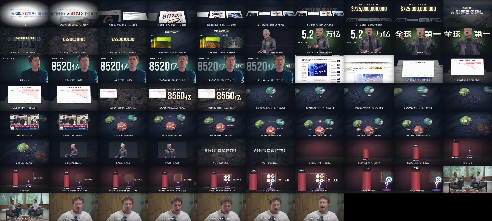

# wallstreet-explainer

> 一个给 Claude Code 用的 Skill，用来做**华尔街式的财经 / 科技解读短片**：1–3 分钟，16:9，不需要真人出镜。
> *A Claude Code skill for making Wall-Street-style finance / tech explainer videos (1–3 min, 16:9, no on-camera host): real news, real people and official footage as evidence; cut-outs of the people in the story stand in for a host (in front of giant type, backgrounds swapping behind them); a layered 2.5D stage — glass discs, big numbers, clean charts — where the camera, not the elements, does the moving; every shot picks up something from the previous one.*


*上图：示例片《AI到底有多烧钱》第六版（77 秒）压成的 GIF，没有声音。图里的实拍画面、人物抠像和新闻截图分属各自的版权方，出处见 [examples/ai-burn-money/CREDITS.md](examples/ai-burn-money/CREDITS.md)。*



*上图：同一条片子，每秒一帧。*


*上图：示例片里四个动作的连续帧：镜头沿新闻桌面滑过去；黄仁勋从实拍原位挪进巨字中间；横推换人（带运动模糊）；原文倒成桌面、图表立起来。*

---

## 这是什么

这个 skill 教 Claude 怎么拍“讲清一笔大账”的片子。题目可以是巨头一年砸多少钱、估值和收入差多少、钱在几家公司之间怎么转了一圈。它包括四样东西：

1. **设计思路**：每一镜该放什么、为什么放、凭什么接下一镜。这是核心，见 `references/thinking.md`。
2. **动效原理**：从三条同类参考片逐帧量出来的镜头运动——为什么它的慢推、数字滚动、压字不像 PPT、不像 AI；一份手法清单和量化目标。见 `references/motion.md`。
3. **风格语言**：深色织物舞台、当事人抠像压巨字、厚玻璃圆盘、奶油金的大数字、白底图表、新闻原文加荧光笔……以及它们的具体数值；还有一份开头钩子菜单。
4. **一套工具脚本**：找片下片、看片挑入点、抽帧、GPU 逐帧抠人、新闻原文截图、临时配音和时间线、逐帧渲染、2.5D 相机小工具、镜头运动自检、混音和响度检查。

**它不是模板。** 仓库里没有一份可以改改文字就出片的工程。每条片的画面都要从它自己的文案和素材里现想；示例片记录的是“怎么想出来的”，不是拿来套的。

**适合**：财经、科技、商业事件的解读；有明确数字和人物关系的题目。
**不适合**：有真人口播出镜的片子、纯情绪混剪、没有数据支撑的观点片。

## 效果是怎么来的（几条核心原则）

- **素材要自己会说话**：画面里要有身份，比如人的脸、logo、新闻标题，静音也能看懂。只有灰屋顶的航拍不行。
- **每一镜都接住上一镜**：同一个数字从开头带到结尾，人物实拍缩成他代表的圆盘，原文里刷黄的数直接飞进图表。
- **真实优先**：用官方高清宣传片、新闻原文、当事人原声；当事人的实拍抠像替代主持人；生成图只演拍不到的具体比喻物件，不做电影感氛围大片。
- **动的是镜头，不是元素自己演**：东西出现得很朴素，大运动交给镜头——在有前后层的舞台里推、拉、摇，去找正在说的那个东西；快的东西带运动模糊。几乎不定住，也不整张平面一起缩放。
- **每个动作都是内容**：删掉它观众少懂了什么？什么都没少就是装饰。数字只在“累加”时滚；实拍上的字只用“人站在巨字前面”或“实拍压暗退成底”两种压法。
- **原声要先铺垫**：先说“连某某自己都说：”，再放他的原话。
- **开头不固定**：每条片按它最强的料（极端的数、反差、当事人一句话、看得见的尺度、悬念……），挑 3 个机制不同的钩子做粗剪给你选。不管选哪个，0.5 秒内开口，第一句说完就进正题。

详细见 `references/`。

## 安装

### 1. 放进 Claude Code 的 skills 目录

```bash
# 个人全局
git clone https://github.com/HeyChengC/wallstreet-explainer.git ~/.claude/skills/wallstreet-explainer
# 或者只给某个项目用
git clone https://github.com/HeyChengC/wallstreet-explainer.git <项目>/.claude/skills/wallstreet-explainer
```

重启 Claude Code 后，在 skill 列表里能看到 `wallstreet-explainer`。

### 2. 装依赖

| 依赖 | 用途 | 安装 |
|---|---|---|
| ffmpeg / ffprobe | 剪辑、抽帧、混音、量响度 | <https://ffmpeg.org>，放进 PATH |
| yt-dlp | 下载参考素材 | `pip install -U yt-dlp`（过期就会被 403，要常更新） |
| Python 3.10+ | 脚本 | `pip install -r requirements.txt` |
| Node.js 18+ 和 Playwright | 逐帧渲染、新闻截图 | 在 skill 目录下 `npm install` 然后 `npx playwright install chromium` |
| faster-whisper（可选） | 换成正式配音后逐字对齐；给原声找词的时间 | `pip install faster-whisper`（有 NVIDIA 显卡会快很多） |
| onnxruntime-gpu + 抠像模型（可选） | 当事人逐帧抠像（`matte.py`） | `pip install "onnxruntime-gpu[cuda,cudnn]" rembg`，再 `python -c "from rembg import new_session; new_session('isnet-general-use')"` 下载模型；没有 NVIDIA 显卡装 `onnxruntime`（慢很多） |

Playwright 装在别处也可以：设环境变量 `PLAYWRIGHT_FROM=<装了 playwright 的那个 package.json 的路径>`，或者在 `scripts/local.json` 里写 `{"playwright_from": "..."}`。

**字体**（不随仓库提供，按各自的授权自行下载）：

| 字体 | 用途 | 授权 |
|---|---|---|
| MiSans | 字幕 | 免费可商用（需遵守小米的字体协议） |
| 阿里妈妈数黑体 | 标签、片名 | 免费可商用 |
| Bebas Neue | 大数字 | SIL OFL |
| Noto Sans SC | 正文兜底 | SIL OFL |
| Century Gothic Italic | 字幕里夹的英文和数字 | 商业字体，可换成 URW Gothic、Questrial 这类免费的几何字体 |

## 怎么用

在 Claude Code 里直接说，例如：

> 用 wallstreet-explainer 做一条 1 分钟的片子：《AI到底有多烧钱》。

Claude 会按下面的流程走，**每一站都停下来让你确认**，审美由你把关：

| 站 | 内容 | 你会看到 |
|---|---|---|
| 0 选题 | 题目要同时满足“现在热”和“看完能带走点什么” | 两三个候选题目 |
| 1 文案 | 句句往下接；插原声的地方写好铺垫句 | 全文 |
| 2 导演表 | 每一镜写清：屏上是什么、观众多懂了什么、接住上一镜的什么 | 导演表要点 |
| 3 素材 | 官方高清片 → 新闻原文 → 当事人原声；先拼联系表再定入点 | 关键素材 |
| 4 配音和时间线 | 先用临时语音排出时间线（见下节） | — |
| 5 开头 | 先给 3 个机制不同的钩子粗剪，你选一个，再做成开头小样 | 3 个钩子粗剪 → 15–20 秒小样 |
| 6 全片 720p | 按导演表铺完 | 720p 全片 + 抽帧图 |
| 7 成片 | 改到满意，换正式配音，出 1080p | 1080p 成片 |

## 配音：先用临时语音

正式配音往往要付费，或者要等真人录。所以流程是：

1. **先用临时语音**。`scripts/temp_voice.py` 调用免费的 edge-tts（默认音色“云希” `zh-CN-YunxiNeural`）给每句话出一条临时配音，同时生成 `timeline.json`，里面有每个字的时刻、原声插段的位置和片名的位置。画面全部挂在这些字的时刻上。
2. **文案和画面都定了，再换正式配音**。正式配音可以是任何 TTS、克隆音色或真人录音。把每句存成 `voice/<句子id>.final.wav`，然后跑：
   ```bash
   python scripts/temp_voice.py film/script.json --asr
   ```
   它会换上正式配音，用 faster-whisper 重新逐字对齐。画面跟着自动顺延，不用改。

不管临时还是正式，配音都这样处理：**每句先切掉首尾静音，保持原速，不要事后加速**（切掉静音后再拉 1.1 倍，听感会很急促），句间停顿只由 `gap` 决定（一般 0.35 秒，换段 0.5 秒）。要说得快一点，就在生成时调语速（edge-tts 的 `rate`），不要事后拉伸。

`script.json` 的写法见 `scripts/temp_voice.py` 的开头。

## 工具脚本

| 脚本 | 做什么 | 例子 |
|---|---|---|
| `footage.py search` | 在 YouTube 搜素材 | `python scripts/footage.py search "NVIDIA Blackwell b-roll"` |
| `footage.py get` | 下载 1080p，可只下一段或只下音频 | `... get <id> --section 01:11:40-01:12:12` |
| `footage.py sheet` | 带时间码的联系表，用眼睛挑镜头 | `... sheet src.mp4 --step 2` |
| `footage.py scenes` | 找镜头切点，入点出点要落在同一个镜头里 | `... scenes src.mp4 --from 200 --to 230` |
| `footage.py extract` | 抽成 30fps 帧序列给渲染用 | `... extract clips.json` |
| `footage.py wave` | 看原声剪口的响度：开口、句尾、数字静音、爆音 | `... wave quote.m4a 17.8 19.2` |
| `snap_news.mjs` | 新闻原文截图，并量出关键词的框（画荧光笔用） | `node scripts/snap_news.mjs jobs.json` |
| `temp_voice.py` | 临时配音和时间线；`--asr` 换正式配音后重新对齐 | `python scripts/temp_voice.py film/script.json` |
| `matte.py` | 实拍逐帧抠人，提示藏着的切点 | `python scripts/matte.py film/assets/clips/ceo film/assets/cut/ceo --from 12` |
| `matte_clean.py` | 抠像去零碎、抹掉贴着的椅背、写出每帧头肩中心 | `python scripts/matte_clean.py film/assets/cut/ceo --cut-left 0.16` |
| `stage25d.js` | 页面里用的小工具：分层相机、运动模糊、景深、抠像跟人、巨字、眉题 | 拷进片子目录，先于 film.js 载入，用 `window.S25` |
| `render.mjs` | 逐帧渲染：看帧、渲一段、出成片 | `node scripts/render.mjs --dir film --video --h 720 --range 0:18` |
| `strip.py` | 连续帧拼图：一个动作 8 张，查穿帮、拆参考片 | `python scripts/strip.py film/out/visual_720.mp4 15.8 16.9 8 out.jpg` |
| `motion_check.py` | 镜头运动自检，和参考片的区间比 | `python scripts/motion_check.py v6.mp4 v5.mp4` |
| `mix.py` | 配音、原声、音效、配乐混到 -14 LUFS；`--check` 量各段响度 | `python scripts/mix.py film --check` |

渲染器要求片子的页面暴露 `window.ready` 和 `window.seek(t)`，同一个 t 永远画出同一帧。片子怎么搭见 `SKILL.md` 最后一节。

## 目录结构

```
wallstreet-explainer/
├── SKILL.md                 # Claude 读的入口：流程、读哪份、工具、片子怎么搭
├── references/
│   ├── thinking.md          # 设计思路（核心）
│   ├── motion.md            # 动效原理：为什么不像 PPT/AI、手法清单、量化目标
│   ├── style.md             # 风格语言和具体数值
│   ├── grammar.md           # 镜头怎么接、运镜和动作的手感
│   ├── opening.md           # 开头：钩子菜单，以及怎么出 3 个选项
│   ├── sourcing.md          # 找片、新闻原文、当事人原声
│   ├── audio.md             # 文案、配音、原声剪口、音效与混音
│   ├── review.md            # 交付前自检
│   └── lessons.md           # 实践中踩过的坑
├── scripts/                 # 工具脚本（见上表）
├── examples/ai-burn-money/  # 示例片：GIF、导演表、逐段说明、每秒一帧、动作连续帧、前后两版对比、素材出处
├── requirements.txt
└── package.json
```

## 素材与版权

- 这个 skill 会下载和引用**有版权的素材**：企业宣传片、新闻画面、新闻网页截图、当事人原声。请只做评论、解读性质的合理引用，**每条片都要在简介里列出所有素材的出处**（示例见 [CREDITS.md](examples/ai-burn-money/CREDITS.md)）。素材的使用风险由使用者自己判断和承担。
- 新闻网页截不到（被验证码拦住）时，可以用核实过的文字自己排一个通用样式的效果图。**不要仿冒任何真实网站的标志、名字和版式**，也不要编造数据。
- 人物的照片和抠像只用授权允许的来源（比如 Wikimedia Commons 上的 CC 许可照片），并注明作者和许可。
- 音效和配乐推荐用 CC0 素材（Openverse / Freesound），保留来源清单。
- 不要用真实博主、电影、品牌的名字给你做的片子或风格命名，也不要冒用他们的形象、声音、口头禅和片头包装。

## 致谢

- 风格是从一类财经解读短视频的剪辑语言里学来的。
- 钩子菜单里的“关键词快闪”，学自一类剪映教程里常见的文字快闪做法。
- 音效来自 Freesound 上的 CC0 作者，经 Openverse 检索。
- 示例片用到的全部素材及出处见 [CREDITS.md](examples/ai-burn-money/CREDITS.md)。

## License

本仓库的**代码和文档**以 MIT License 发布，见 [LICENSE](LICENSE)。
示例图里出现的第三方画面、新闻截图、logo 和人物照片**不在 MIT 授权范围内**，版权归各自所有者，出处见 CREDITS.md。
